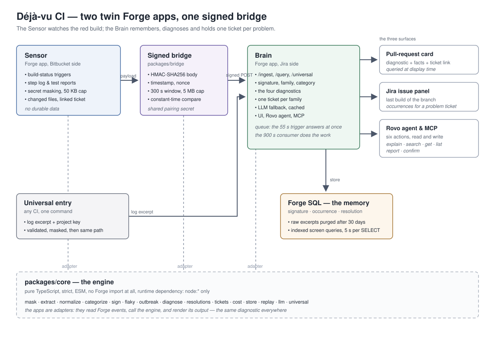

# Déjà-vu CI — CI failures with memory

**Every red build is recognised, classified in seconds, and kept in memory: one ticket per problem, not per occurrence.**

Déjà-vu CI is a pair of Atlassian Forge apps for Bitbucket Pipelines. The *Sensor* watches failed
builds, extracts the error, and sends it over a signed bridge. The *Brain* (Jira side) computes a
deterministic signature, stores it in Forge SQL, and answers one of four diagnostics — with the
facts that justify it — on the pull request, on the Jira ticket, to a Rovo agent, and through six
MCP actions.

---

## The four diagnostics

| Diagnostic | What the developer sees | Suggested action |
|---|---|---|
| **Known flaky** | "This test fails at random: seen 17 times on 9 branches, ticket PAY-88. Probably unrelated to your PR." | Retry |
| **Already seen, already fixed** | "Same error on 3 November on `main`, fixed by Marie in `abc123` (HTTP client update). Your branch predates that fix." | Rebase or cherry-pick the fix |
| **New** | "First appearance. The step passed on the previous commit. Suspect changed files: `refund/Limiter.java`." | Fix |
| **Infrastructure** | "Package registry unreachable. 6 other repositories have failed the same way for 10 minutes." | Wait, retry |

A fifth, cautious verdict — *uncertain* — is used whenever the confidence is below the configured
threshold: the app then shows the facts instead of blaming (or exonerating) the pull request.

---

## Try it in 2 minutes without Bitbucket

```bash
npm ci
npm run replay
```

The replay runs the bundled 40-failure, 14-day sample dataset against an in-memory store and
prints, with no network access and no Atlassian tenant:

1. the **signatures** it computed (id, family, category, status, occurrence count);
2. the **diagnostic** attached to every failure, with its confidence and facts;
3. the **ticket actions** it would replay in Jira (create / update / comment / reopen);
4. the **four counters** — one per expected diagnostic — so you can check the recipe at a glance.

```bash
npm run eval     # accuracy of grouping and false-"flaky" rate on the 100-failure labelled corpus
```

> **Status of the commands:** everything above is in this repository — the engine
> (`packages/core/src/**`), the sample dataset (`data/sample/occurrences.json`), the labeled corpus
> (`data/labeled/100-failures.json`) and the tools (`tools/**`). Measured on the current `main`:
> grouping **100 %**, categories **100 %**, false "flaky" **0 %**, 336 automated tests green, and
> the § 20 acceptance recipe replayed end to end by `npm run replay`.

---

## Architecture in one picture



Two twin Forge apps, one signed bridge, one memory:

- **Sensor** (`apps/sensor`, Bitbucket scopes) — sees the red build, reads the step log and the
  test report, masks secrets, forwards error blocks. Holds **no durable data**.
- **Bridge** (`packages/bridge`) — HMAC-SHA256 signature, timestamp, nonce, shared secret from
  the pairing. Constant-time comparison, 300 s skew window, 5 MB body cap.
- **Brain** (`apps/brain`, Jira side) — computes signatures, stores occurrences in Forge SQL,
  diagnoses, holds the tickets, hosts the UI, the Rovo agent and the MCP actions.
- **`packages/core`** — the whole engine, pure TypeScript, **zero Forge imports**, unit-tested.

Full details: [docs/ARCHITECTURE.md](docs/ARCHITECTURE.md).

---

## Installing the two apps

> **Status:** both manifests (`apps/sensor/manifest.yml`, `apps/brain/manifest.yml`) and their
> resolvers are in this repository. Deploying them needs a Forge API token and an Atlassian site
> (`forge deploy` / `forge install`), which this repository does not ship: the steps below are the
> procedure to run on your own tenant, and the pairing contract they implement. Everything the apps
> compute is exercised here without a tenant — `npm run replay` and the 336 automated tests.

**1. The Brain (Jira side) — the useful one on its own**

```bash
cd apps/brain && forge install && forge deploy
```

It registers the web trigger, the SQL storage, the LLM fallback, the project page, the issue
context, the settings page, the Rovo agent and the MCP server. On its own it is already useful:
the universal entry and the replay work without any Bitbucket connection.

**2. The Sensor (Bitbucket side)**

```bash
cd apps/sensor && forge install && forge deploy
```

**3. Pairing the two apps** (the `pairing` row of the SQL schema)

- In the Brain: open the project settings page, generate a pairing secret (stored in the Forge
  secret storage, never in a log and never in this repository).
- In the Sensor: open the workspace settings page, paste the pairing secret and the Brain's
  web-trigger URL.
- The Brain answers with the workspace key; both sides now share one secret.

**4. Scope review.** The Sensor requests `read:repository:bitbucket`,
`read:pipeline:bitbucket`, `read:pullrequest:bitbucket` and `storage:app`. The Brain requests the
Jira scopes only. The two scope families are deliberately never mixed in a single app — see
ADR 0001.

---

## The universal entry — one command for any CI

Any CI can feed Déjà-vu CI without Bitbucket. A one-line command at the end of the pipeline sends
the log excerpt to the Brain's `/universal` web trigger, authenticated by a per-project key:

```bash
tools/universal-entry.sh --project-key CI --repository my-repo --branch main --log-file step.log
```

The payload is validated, capped at 50 KB, masked, and then follows exactly the same path as the
Sensor. GitHub Actions, GitLab CI and Jenkins are the intended first users.

> **Status:** `tools/universal-entry.sh` is in this repository, and so is the validation and
> conversion it relies on (`packages/core/src/universal.ts`) and the `/universal` route of the Brain
> (`apps/brain/src/universal.ts`).

---

## The Rovo agent and the six MCP actions

The Rovo agent **Déjà-vu CI** lives in the Brain and answers questions like:

- "Why is the build of PAY-123 red?"
- "Have we already seen this error?" (with a pasted excerpt)
- "What are our most flaky tests?"
- "Who fixed the database connection error last time?"

The same six actions are exposed to external MCP clients (`rovo:mcp`):

| Key | Verb | Inputs | Returns |
|---|---|---|---|
| `explain-build-failure` | GET | `issueKey` or `buildUrl` | Diagnostic, confidence, justification, suggested action |
| `search-failures` | GET | `text`, optional `repository` | Signatures close to a pasted error |
| `get-signature` | GET | `signatureId` | History, status, resolution, ticket |
| `list-flaky-tests` | GET | `repository`, `days` | Flaky tests ranked by cost |
| `report-resolution` | CREATE | `signatureId`, `commit`, `note` | Recorded resolution |
| `confirm-resolution` | UPDATE | `signatureId`, `confirmed` | Resolution confirmed or rejected |

---

## Requirements traceability (CI-01 … CI-19)

Source of truth: the frozen contract `docs/CONTRACTS.md`. *Status* tells what is really in this
repository — `shipped` = present in the tree today; `planned` = deliberately not implemented yet.

| # | Requirement | Where it lives | Status |
|---|---|---|---|
| CI-01 | Capture every failed build status | `apps/sensor/manifest.yml` triggers, `apps/sensor/src/index.ts` | shipped |
| CI-02 | Read the failed step log and failed test cases | `apps/sensor/src/pipelines.ts` | shipped |
| CI-03 | Mask secrets before anything leaves Bitbucket | `packages/core/src/mask.ts` | shipped |
| CI-04 | Signature, family and category (§ 9) | `packages/core/src/sign.ts`, `packages/core/src/categorize.ts` | shipped |
| CI-05 | One of four diagnostics, with confidence and justification | `packages/core/src/diagnose.ts`, `apps/brain/src/ingest.ts` | shipped |
| CI-06 | Flaky detection (§ 10.1) | `packages/core/src/flaky.ts` | shipped |
| CI-07 | One ticket per problem (§ 11) | `packages/core/src/tickets.ts` | shipped |
| CI-08 | Diagnostic on the pull request and on the Jira ticket | `apps/sensor` PR card, `apps/brain/src/ui/` issue panel | shipped |
| CI-09 | "CI Memory" project page | `apps/brain/src/ui/` project page | shipped |
| CI-10 | Rovo agent and MCP tools (§ 13) | `apps/brain/src/rovo/`, `apps/brain/src/actions/` | shipped |
| CI-11 | Replayable sample set without Bitbucket | `packages/core/src/replay.ts`, `data/sample/`, `tools/replay.mjs` | shipped |
| CI-12 | Deduce then confirm resolutions | `packages/core/src/resolutions.ts`, `apps/brain/src/actions/` | shipped |
| CI-13 | Detect regressions, reopen the ticket, mention the fix author | `packages/core/src/resolutions.ts` (`detectRegression`), `packages/core/src/tickets.ts` | shipped |
| CI-14 | Cost: red builds, CI minutes lost, people affected | `packages/core/src/cost.ts`, `apps/brain/src/ui/` cost tab | shipped |
| CI-15 | Detect infrastructure outbreaks, open one incident | `packages/core/src/outbreak.ts` | shipped |
| CI-16 | Universal entry for any CI | `packages/core/src/universal.ts`, `tools/universal-entry.sh` | shipped |
| CI-17 | Manually merge or split signatures | — | planned (not in the frozen contract) |
| CI-18 | Adjustable retention of raw excerpts | `packages/core/src/store.ts` (`purgeExpired`), `rawRetentionDays` setting | shipped |
| CI-19 | Propose quarantining a test | — | planned (post-hackathon, § 6 "Vision") |

Also shipped today, as part of the foundation: the frozen domain types
(`packages/core/src/types.ts`) and the signed bridge (`packages/bridge/src/index.ts`).

---

## The six points still to validate (§ 17)

None of them has been validated yet — they are the first-week prototype checklist of the
specification, and the answer column says what the fallback is when the first option fails.

| Point to validate | Why it matters | Fallback |
|---|---|---|
| Find the pipeline and its steps from a build status | Without it, there is no log | List the recent pipelines of the commit |
| Read a step log from Forge | A community thread reports it failing | Test reports only; universal entry |
| Availability of test reports | They exist only when the pipeline produces result files | Log analysis |
| Event emitted when a step is retried on the same commit | It grounds flaky detection | Compare successive statuses of one commit |
| Extra scope to read tests | A page mentions a dedicated test scope | Add it to the manifest |
| Calling a web trigger from the Bitbucket app | This *is* the bridge | Universal entry called from the pipeline |

---

## Repository layout

```
packages/core      pure engine: masking, extraction, normalisation, signature,
                   diagnosis, memory, replay, universal entry — no Forge import
packages/bridge    signed bridge between the two apps
apps/sensor        Forge app, Bitbucket side (Sensor)
apps/brain         Forge app, Jira side (Brain): server, UI, Rovo agent, MCP
data               sample dataset and labelled corpus
tools              replay, accuracy evaluation, universal entry
docs               this documentation
```

## Documentation

| Document | Content |
|---|---|
| [docs/ARCHITECTURE.md](docs/ARCHITECTURE.md) | Twin apps, signed bridge, data model, Forge limits |
| [docs/JUDGES.md](docs/JUDGES.md) | Step-by-step test walkthrough and the 9-point recipe |
| [docs/DEMO.md](docs/DEMO.md) | 5-minute video script |
| [docs/ROADMAP.md](docs/ROADMAP.md) | V1, long-term vision, out of scope |
| [docs/ADRs/](docs/ADRs/) | Why two twin apps, why Jira-side memory, deterministic signature first |
| [docs/cahier-des-charges.md](docs/cahier-des-charges.md) | The original specification (French) |

## Licence

MIT — see the `license` field of `package.json`.
