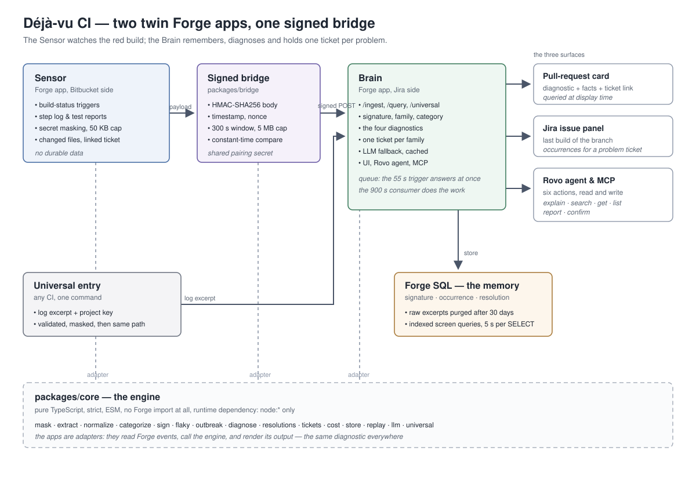

# Architecture — Déjà-vu CI

Déjà-vu CI is a **pair of twin Atlassian Forge apps** joined by a **signed web-trigger bridge**.
This document explains why, how the data flows, what the data model is, what Forge allows and
therefore imposes, and how the code is cut.



---

## 1. Why two apps

A Forge app cannot call Bitbucket *and* Jira at the same time: the two scope families do not
combine, and the multi-app compatibility page only lists Jira and Confluence. A single app that
"just talks to both" is therefore not an option.

| | **Sensor** (Bitbucket) | **Brain** (Jira) |
|---|---|---|
| Role | See the red build, read logs and test reports, extract error blocks | Compute signatures, remember, diagnose, hold the tickets |
| Modules | Event triggers, pull-request card, workspace settings page | Web trigger, SQL, LLM, project page, issue panel, Rovo agent, actions, MCP |
| Durable data | **None** | **All the memory** |

The memory lives on the Jira side for three reasons: that is where the tickets, the Rovo agent and
the MCP server live; that is where Forge SQL is available; and that is where the human reviewers
already work.

This decision is recorded in [ADRs/0001-deux-apps-jumelees.md](ADRs/0001-deux-apps-jumelees.md).

---

## 2. The signed bridge

The Sensor cannot write into the Brain's database. It calls the Brain's web trigger. That call
crosses a trust boundary, so it is signed.

**Envelope** (JSON body):

```json
{ "v": 1, "nonce": "<hex 16>", "ts": 1762737600, "payload": { "...": "IngestPayload" } }
```

**Headers**:

| Header | Content |
|---|---|
| `x-dejavu-signature` | `HMAC-SHA256(secret, "<ts>.<nonce>.<body>")`, hexadecimal |
| `x-dejavu-timestamp` | Unix timestamp in seconds |
| `x-dejavu-nonce` | 16 hexadecimal characters, unique per request |

Signing the timestamp and the nonce **together with the body** prevents three attacks at once: a
signature cannot be replayed on another body, a timestamp cannot be aged without breaking the
HMAC, and two identical bodies sent twice are distinguishable by their nonce.

**Verification** (`packages/bridge/src/index.ts`) refuses, in this order:

- a missing or wrong signature (compared in **constant time**, `timingSafeEqual`);
- a timestamp outside the **300 s** window (`maxSkewS`);
- a nonce already seen (`seenNonce` callback);
- a body larger than **5 MB** (the Forge payload limit).

The shared secret is established during pairing and stored in the **Forge secret storage** — never
in a log, never in this repository, never in a pull request.

---

## 3. The flow, step by step (§ 15)

1. Bitbucket emits a build-status event. Only the **failed** state is processed; successes are
   only useful to record "the same step passed on the same commit" (the basis of flaky detection).
2. The Sensor finds the pipeline from the URL carried by the status, lists its steps, reads the
   tail of the failed step's log by **partial request** (logs can be tens of megabytes), then the
   test reports and the failure reason of each failed test case.
3. The Sensor **masks the secrets**, keeps the error blocks (**50 KB max**) and sends to the Brain:
   repository, branch, commit, author, pull request, step, duration, error blocks, changed files,
   the linked Jira ticket when there is one.
4. The Brain's web trigger **verifies the signature**, puts the message in a queue and **answers
   immediately** — the 55 s web-trigger budget is never spent on analysis.
5. The **consumer** computes the signature and the diagnostic, records the occurrence, and updates
   the single ticket of the problem.
6. The pull-request card **queries the Brain at display time** — the card is always fresh, and a
   query that finds nothing costs nothing.

The same ingestion path is used by the **universal entry** (`/universal`): any CI can send a log
excerpt with a one-line command and a per-project key. The payload is validated, capped at 50 KB,
masked, and then follows steps 5 and 6 exactly.

---

## 4. Data model (§ 16)

Forge SQL, on the Brain side.

| Table | Main columns |
|---|---|
| `signature` | id, family_id, category, error_type, template, frames, status, first_seen, last_seen, occurrences, issue_key |
| `occurrence` | id, signature_id, workspace, repo, branch, commit, author, pr_id, step_name, duration_s, build_url, occurred_at, passed_on_retry |
| `test_stats` | repo, test_name, runs_failed, runs_passed_same_commit, branches, flaky_index, updated_at |
| `resolution` | id, signature_id, commit, author, files_json, note, confidence, confirmed_by, confirmed_at |
| `raw_excerpt` | occurrence_id, text, expires_at |
| `llm_template_cache` | normalized_hash, template, category |
| `outbreak` | id, family_id, started_at, repos_json, incident_key |
| `pairing`, `settings` | pairing with Bitbucket, project settings |

Two indexes are enough for every screen query: one on `signature.family_id`, one on
`occurrence(signature_id, occurred_at)`. **No foreign keys** — Forge SQL does not support them.

The DDL is a single exported constant, `SQL_SCHEMA`, in `packages/core/src/store.ts` (store lot):
one definition, used both by the schema creation and by the documentation.

The **signature** is the pivot of the whole model:

- **signature** = `sha256(category | errorType | normalizedMessage | reducedStack)`, truncated to 16
  hex characters — two occurrences with the same signature *are* the same error;
- **family** = the same hash without the stack — a looser bucket that gathers the variants of one
  problem, and the uniqueness key of the Jira ticket (§ 11);
- the human-readable form is `S-204`.

---

## 5. What Forge allows — and therefore imposes

These are not design choices, they are platform constraints. Every one of them has a consequence in
the code.

| Forge limit | Consequence in the design |
|---|---|
| **Web trigger: 55 s** | The trigger **queues** the message and answers immediately. All analysis happens in the consumer, asynchronously. |
| **Async function: 900 s** | One failure is analysed end-to-end well within the budget; a batch of a hundred is still fine, which is what the daily scheduled trigger does. |
| **Payload: 5 MB** | The bridge refuses anything larger; the Sensor caps the error blocks at 50 KB. |
| **SQL: 1 GiB per installation** | Raw excerpts are the only bulky data and they are purged (30 days by default, adjustable). Signatures and statistics are kept forever. |
| **SQL: 5 s per SELECT** | Every screen query is indexed and bounded; the "CI Memory" page filters and paginates. |
| **No foreign keys in SQL** | Referential integrity is enforced by the store layer, not by the database. |
| **LLM: 100 requests/minute per installation** | The model is a **fallback only** (when no pattern recognised the block), and its answers are cached by normalised text: the same raw error is never submitted twice. |
| **No mixed Bitbucket + Jira scopes** | Two twin apps (section 1). |
| **Secrets must live in the secret storage** | The pairing secret is never in the repository, never in a log, never in a ticket. |
| **Forge functions are stateless** | All the memory is in SQL; the queue is also SQL. |

One more platform fact worth stating plainly: **the signature is computed before the model is
consulted**. The LLM never decides what an error is; it only fills a gap when no known pattern
matched, and its result is cached. See
[ADRs/0003-signature-deterministe-avant-llm.md](ADRs/0003-signature-deterministe-avant-llm.md).

---

## 6. How the code is cut

```
packages/core      the engine — pure TypeScript, no Forge import at all
packages/bridge    the signed bridge — Node crypto only
apps/sensor        Forge app (Bitbucket): resolvers, adapters
apps/brain         Forge app (Jira): server modules, UI, Rovo agent, MCP actions
```

**`packages/core` never imports `@forge/api`.** It is plain TypeScript with strict mode, ESM and
`module: NodeNext`, and it only depends on `node:*` at runtime. This is what makes the whole
diagnostic engine unit-testable without a tenant, without a network, and fast — the CI job stays
well inside its 5-minute budget.

**The apps are adapters.** They read Forge events, call the engine, and render its output:

- the Sensor resolves a Forge event into an `IngestPayload`, and the pure part of that work lives
  in `apps/sensor/src/pure/` so it can be tested;
- the Brain wires modules: `index.ts` exports `ingest`, `query`, `universal`, `consumer`,
  `scheduled`, `projectPage`, `issueContext`, `settingsPage` and the six actions — and **no logic
  of its own**. Everything comes from `@dejavu/core`.

The consequence is the important part: **the same diagnostic can be produced by the Sensor's
replay, by the universal entry, by the SQL query of the pull-request card, and by the Rovo agent**
— because they all call the same functions.

**The frozen contract.** `docs/CONTRACTS.md` and `packages/core/src/types.ts` are frozen: the
signature of every exported function is decided before any code is written, so the eight parallel
implementation lots could be developed without ever meeting each other.

---

## 7. Test strategy

- The engine is unit-tested in `packages/**/test/*.test.ts`; the apps are tested in
  `apps/**/test/*.test.ts`.
- **No test touches the network.** The sample dataset is replayed locally, which is also how the
  judges can test the product without Bitbucket.
- `npm run replay` replays the 40-failure sample set end to end; `npm run eval` measures the
  grouping accuracy and the false-"flaky" rate on the 100-failure labelled corpus.
- The CI jobs (`ci`, `ci-budget`, `couche0`) are all capped at **5 minutes** per job.

---

## 8. Repository layout and tooling

```
packages/core/src   types.ts (frozen), mask, extract, normalize, categorize, sign,
                    flaky, outbreak, diagnose, resolutions, tickets, cost,
                    store, replay, llm, universal
packages/bridge/src signPayload, verifyRequest, BRIDGE_HEADERS
apps/sensor         manifest.yml, index.ts, pipelines.ts, buildPayload.ts,
                    settings.ts, ancestry.ts, pure/
apps/brain          manifest.yml, index.ts, ingest, query, universal, consumer,
                    scheduled, settings, ui/, rovo/, actions/
data                sample/occurrences.json, labeled/100-failures.json
tools               replay.mjs, eval-accuracy.mjs, universal-entry.sh
```

**Tooling note for the runners.** The self-hosted CI runners do not have Node on the `PATH`: it
is installed once for the runner's user under `~/.local/node`, and the `ci` job adds
`$HOME/.local/node/bin` to the `PATH` before running the checks.

---

## 9. Further reading

| Document | Content |
|---|---|
| [JUDGES.md](JUDGES.md) | Step-by-step test walkthrough, and the 9-point recipe with the command that verifies each point |
| [DEMO.md](DEMO.md) | The 5-minute video script |
| [ROADMAP.md](ROADMAP.md) | V1, the long-term vision, what is explicitly out of scope |
| [ADRs/](ADRs/) | The three decisions that shaped the product |
| [cahier-des-charges.md](cahier-des-charges.md) | The original specification (French) |
| [../README.md](../README.md) | The judges' entry point |
